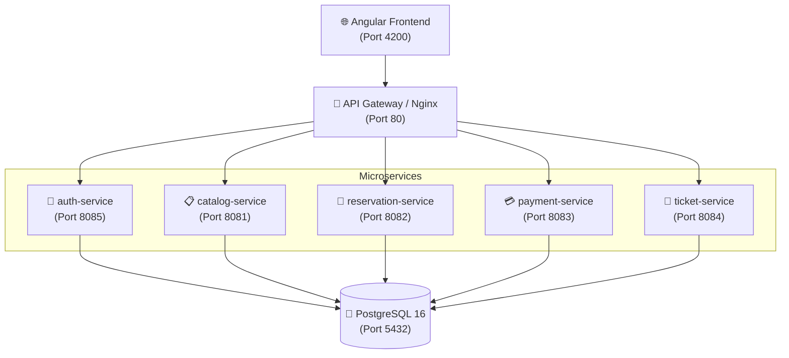

# 🚌 BusBook — Plateforme de Réservation de Bus Interurbains au Maroc


> Projet académique M2 — Architecture microservices pour la gestion et la réservation de voyages en bus interurbains au Maroc.

---

## 📋 Table des matières

1. [Description](#-description)
2. [Architecture](#-architecture)
3. [Services](#-services)
4. [Stack technique](#-stack-technique)
5. [Prérequis](#-prérequis)
6. [Démarrage rapide (Docker)](#-démarrage-rapide-docker)
7. [Développement local](#-développement-local)
8. [Variables d'environnement](#-variables-denvironnement)
9. [Endpoints API](#-endpoints-api)
10. [Tests](#-tests)
11. [Structure du projet](#-structure-du-projet)
12. [Données initiales](#-données-initiales)
13. [Commandes Docker utiles](#-commandes-docker-utiles)

---

## 📖 Description

**BusBook** est une plateforme de réservation de tickets de bus interurbains au Maroc, développée en architecture **microservices**. Elle permet aux voyageurs de :

- 🔍 Consulter les trajets disponibles (Agadir, Casablanca, Marrakech, Tanger, Rabat…)
- 💺 Réserver des sièges avec un système de blocage temporaire (10 minutes)
- 💳 Effectuer un paiement en ligne
- 🎫 Recevoir un e-ticket avec QR code
- 🔐 S'authentifier de manière sécurisée via JWT

---

## 🏗️ Architecture



---

## 🧩 Services

| Service | Port | Description | Dockerfile |
|---|---|---|---|
| `catalog-service` | **8081** | Gestion des bus et des trajets (CRUD complet) | `catalog-service/Dockerfile` |
| `reservation-service` | **8082** | Réservation de sièges avec blocage temporaire (10 min) | `reservation-service/Dockerfile` |
| `payment-service` | **8083** | Traitement des paiements | `payment-service/Dockerfile` |
| `ticket-service` | **8084** | Génération d'e-tickets avec QR code | `ticket-service/Dockerfile` |
| `auth-service` | **8085** | Authentification JWT (inscription, connexion) | `auth-service/Dockerfile` |
| `busbook-angular-frontend` | **4200** (dev) / **80** (prod) | Interface utilisateur Angular 19 | `busbook-angular-frontend/Dockerfile` |

---

## 🛠️ Stack technique

| Couche | Technologie | Version |
|---|---|---|
| Backend | Java + Spring Boot | 21 / 4.1.2 |
| Frontend | Angular (zoneless, signals) | 19 |
| Base de données | PostgreSQL | 16 |
| ORM | Spring Data JPA / Hibernate | — |
| Authentification | Spring Security + JWT | — |
| Conteneurisation | Docker + Docker Compose | — |
| Serveur web | Nginx (alpine) | latest |
| Tests backend | JUnit 5 + Mockito | — |
| Tests frontend | Jasmine + Karma | — |
| Build Java | Maven Wrapper (`mvnw`) | — |
| Build Angular | Angular CLI + npm | — |

---

## ✅ Prérequis

Avant de commencer, assurez-vous d'avoir installé :

- **JDK 21** — [Eclipse Adoptium Temurin 21](https://adoptium.net/)
- **Node.js 18+** et **npm**
- **Docker Desktop** — [docker.com](https://www.docker.com/products/docker-desktop/)
- **Git**

> [!NOTE]
> Sur Windows, le Maven Wrapper (`.\mvnw.cmd`) doit être utilisé à la place de `mvn`. Pensez à définir `$env:JAVA_HOME` si votre JDK n'est pas détecté automatiquement.

---

## 🚀 Démarrage rapide (Docker)

La méthode la plus simple pour lancer toute la plateforme en un seul commande :

```bash
# 1. Cloner le dépôt
git clone https://github.com/votre-utilisateur/busbook-webservices.git
cd busbook-webservices

# 2. Construire toutes les images Docker
docker compose build

# 3. Lancer tous les conteneurs en arrière-plan
docker compose up -d

# 4. Vérifier que tous les services sont en cours d'exécution
docker compose ps
```

L'application sera accessible à l'adresse : **http://localhost**

---

## 💻 Développement local

### 1. Démarrer la base de données PostgreSQL (Docker)

```bash
docker run -d \
  --name busbook-postgres \
  -e POSTGRES_DB=busbook \
  -e POSTGRES_USER=postgres \
  -e POSTGRES_PASSWORD=postgres \
  -p 5432:5432 \
  postgres:16-alpine
```

> [!TIP]
> Si vous utilisez le `docker-compose.yml`, le conteneur postgres est déjà inclus et s'appelle `busbook-postgres`. Il est mappé sur le port **5433** pour éviter les conflits avec un PostgreSQL local (port 5432).

### 2. Compiler les microservices (Windows PowerShell)

```powershell
# Définir JAVA_HOME si nécessaire
$env:JAVA_HOME = "C:\Program Files\Eclipse Adoptium\jdk-21.0.12.101-hotspot"

# Compiler chaque service (exemple pour catalog-service)
cd catalog-service
.\mvnw.cmd package -DskipTests
cd ..

# Répéter pour chaque service :
# reservation-service, payment-service, ticket-service, auth-service
```

### 3. Lancer les services

Lancez chaque service depuis IntelliJ IDEA **ou** via la ligne de commande :

```powershell
# Exemple pour catalog-service
cd catalog-service
java -jar target\catalog-service-*.jar
```

| Service | Commande de lancement | Port |
|---|---|---|
| catalog-service | `java -jar target\catalog-service-*.jar` | 8081 |
| reservation-service | `java -jar target\reservation-service-*.jar` | 8082 |
| payment-service | `java -jar target\payment-service-*.jar` | 8083 |
| ticket-service | `java -jar target\ticket-service-*.jar` | 8084 |
| auth-service | `java -jar target\auth-service-*.jar` | 8085 |

### 4. Lancer le frontend Angular

```bash
cd busbook-angular-frontend
npm install
npm run start
# → Accessible sur http://localhost:4200
```

---

## 🔧 Variables d'environnement

Les services utilisent les variables d'environnement suivantes (avec valeurs par défaut) :

| Variable | Valeur par défaut | Description |
|---|---|---|
| `SPRING_DATASOURCE_URL` | `jdbc:postgresql://localhost:5432/busbook` | URL de connexion PostgreSQL |
| `DB_PASSWORD` | `postgres` | Mot de passe PostgreSQL |
| `JWT_SECRET` | *(défini dans application.properties)* | Clé secrète pour les tokens JWT |
| `RESERVATION_SERVICE_URL` | `http://reservation-service:8082` | URL interne du service de réservation |
| `CATALOG_SERVICE_URL` | `http://catalog-service:8081` | URL interne du service de catalogue |

> [!IMPORTANT]
> En production, ne jamais exposer `JWT_SECRET` ou `DB_PASSWORD` en clair. Utilisez Docker Secrets ou un gestionnaire de secrets externe.

---

## 📡 Endpoints API

### `catalog-service` — Port 8081

| Méthode | Endpoint | Description |
|---|---|---|
| `GET` | `/api/trips` | Lister tous les trajets disponibles |
| `GET` | `/api/trips/{id}` | Détails d'un trajet |
| `GET` | `/api/trips/search` | Rechercher par origine/destination/date |
| `GET` | `/api/buses` | Lister tous les bus |
| `POST` | `/api/buses` | Ajouter un bus |
| `GET` | `/health` | Health check |

### `reservation-service` — Port 8082

| Méthode | Endpoint | Description |
|---|---|---|
| `POST` | `/api/reservations` | Créer une réservation (hold 10 min) |
| `GET` | `/api/reservations/{id}` | Détails d'une réservation |
| `GET` | `/api/reservations/trip/{tripId}` | Réservations d'un trajet |
| `PUT` | `/api/reservations/{id}/confirm` | Confirmer une réservation |
| `DELETE` | `/api/reservations/{id}` | Annuler une réservation |

### `payment-service` — Port 8083

| Méthode | Endpoint | Description |
|---|---|---|
| `POST` | `/api/payments` | Initier un paiement |
| `GET` | `/api/payments/{id}` | Statut d'un paiement |
| `PUT` | `/api/payments/{id}/confirm` | Confirmer un paiement |

### `ticket-service` — Port 8084

| Méthode | Endpoint | Description |
|---|---|---|
| `POST` | `/api/tickets` | Générer un ticket (avec QR code) |
| `GET` | `/api/tickets/{id}` | Récupérer un ticket |
| `GET` | `/api/tickets/reservation/{reservationId}` | Ticket par réservation |

### `auth-service` — Port 8085

| Méthode | Endpoint | Description |
|---|---|---|
| `POST` | `/api/auth/register` | Inscription d'un nouvel utilisateur |
| `POST` | `/api/auth/login` | Connexion et obtention du token JWT |
| `GET` | `/api/auth/validate` | Valider un token JWT |

---

## 🧪 Tests

### Tests backend (JUnit 5 + Mockito)

```powershell
# Depuis la racine de chaque service
$env:JAVA_HOME = "C:\Program Files\Eclipse Adoptium\jdk-21.0.12.101-hotspot"
cd catalog-service
.\mvnw.cmd test
```

> Les tests utilisent une base de données **H2 en mémoire** (configurée dans `src/test/resources/application-test.properties`).

### Tests frontend (Jasmine + Karma)

```bash
cd busbook-angular-frontend

# Exécution unique (CI)
npm test -- --watch=false

# Mode watch (développement)
npm test
```

> **Résultats** : 61/61 tests Angular passent ✅

---

## 📁 Structure du projet

```
busbook-webservices/
│
├── catalog-service/                  # Service catalogue (bus & trajets)
│   ├── src/main/java/
│   │   └── com/busbook/catalog/
│   │       ├── controller/           # BusController, TrajetController
│   │       ├── service/              # BusService, TrajetService
│   │       ├── entity/               # Bus, Trajet
│   │       ├── dto/                  # DTOs de requête/réponse
│   │       ├── repository/           # Spring Data JPA repos
│   │       └── config/               # CORS, DataInitializer
│   ├── src/test/
│   ├── Dockerfile
│   └── pom.xml
│
├── reservation-service/              # Service de réservation
│   ├── src/main/java/
│   │   └── com/busbook/reservation/
│   │       ├── controller/
│   │       ├── service/
│   │       ├── entity/               # Reservation, Seat (FetchType.EAGER)
│   │       └── repository/
│   ├── src/test/resources/
│   │   └── application-test.properties   # H2 pour les tests
│   ├── Dockerfile
│   └── pom.xml
│
├── payment-service/                  # Service de paiement
│   ├── src/main/java/
│   ├── Dockerfile
│   └── pom.xml
│
├── ticket-service/                   # Génération d'e-tickets + QR code
│   ├── src/main/java/
│   ├── Dockerfile
│   └── pom.xml
│
├── auth-service/                     # Authentification JWT
│   ├── src/main/java/
│   ├── Dockerfile
│   └── pom.xml
│
├── busbook-angular-frontend/         # Application Angular 19
│   ├── src/
│   │   ├── app/
│   │   │   ├── core/services/        # TripService, AuthService…
│   │   │   ├── features/
│   │   │   │   ├── home/             # Page d'accueil (signals)
│   │   │   │   └── trips/            # Catalogue des trajets
│   │   │   └── shared/               # Composants partagés
│   │   └── environments/
│   │       └── environment.ts        # catalogApiUrl: 'http://localhost:8081/api'
│   ├── nginx.conf                    # Config Nginx (SPA + try_files)
│   ├── Dockerfile
│   └── package.json
│
├── docker-compose.yml                # Orchestration complète
└── README.md
```

---

## 🌍 Données initiales

Au démarrage, le `catalog-service` injecte automatiquement des données de test via un `DataInitializer` :

**4 bus pré-configurés :**

| Nom | Type |
|---|---|
| Bus Confort | Confort |
| Bus VIP | VIP |
| Bus Standard | Standard |
| Bus Executive | Executive |

**7 trajets marocains pré-chargés :**

| Origine | Destination |
|---|---|
| Agadir | Casablanca |
| Casablanca | Agadir |
| Agadir | Marrakech |
| Casablanca | Marrakech |
| Marrakech | Casablanca |
| Casablanca | Tanger |
| Tanger | Rabat |

---

## 🐳 Commandes Docker utiles

```bash
# Construire toutes les images
docker compose build

# Lancer tous les services en arrière-plan
docker compose up -d

# Vérifier l'état de tous les conteneurs
docker compose ps

# Voir les logs d'un service en temps réel
docker compose logs -f catalog-service

# Arrêter tous les services (sans supprimer les volumes)
docker compose stop

# Arrêter et supprimer les conteneurs + réseau
docker compose down

# Arrêter et supprimer TOUT (y compris les volumes/données)
docker compose down -v

# Reconstruire et relancer un service spécifique
docker compose up -d --build catalog-service
```

---

## 🖼️ Images Docker produites

| Image | Taille |
|---|---|
| `busbook-catalog-service:latest` | ~122 MB |
| `busbook-auth-service:latest` | ~130 MB |
| `busbook-reservation-service:latest` | ~124 MB |
| `busbook-payment-service:latest` | ~124 MB |
| `busbook-ticket-service:latest` | ~124 MB |
| `busbook-frontend:latest` | ~26.5 MB |

> Les images Java utilisent `eclipse-temurin:21-jre-alpine` pour minimiser la taille. Le frontend utilise `nginx:alpine`.

---

## 👥 Auteurs

Projet développé dans le cadre du Master 2 en Génie Logiciel.

---

## 📄 Licence

Ce projet est sous licence MIT. Voir le fichier [LICENSE](LICENSE) pour plus de détails.
